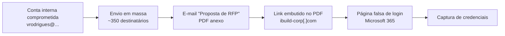

# 🚨 Incident Response — Phishing em Massa & Account Takeover (M365)

> Estudo de caso real: envio massivo de e-mails com **PDF malicioso** a partir de uma **conta corporativa interna comprometida**. Este repositório documenta a triagem, a contenção e as lições aprendidas.

## 📌 Resumo executivo

| Item | Detalhe |
| :--- | :--- |
| **Vetor** | Conta corporativa interna comprometida (`AuthAs: Internal`) |
| **Alcance** | ~350 destinatários |
| **Assunto** | "Proposta de RFP" |
| **Anexo** | PDF com link embutido |
| **Objetivo do atacante** | Captura de credenciais via página falsa de login Microsoft |
| **Classificação** | Phishing em massa + Account Takeover (ATO) |

O caso é representativo de um padrão comum: **não havia malware** no anexo, e sim uma cadeia de engenharia social usando infraestrutura legítima e uma conta válida.

## 🔗 Cadeia do ataque

## 🕵️ Triagem técnica

### 1. Identificação do vetor

- A mensagem partiu de uma **conta legítima da organização**.
- Cabeçalhos indicavam `AuthAs: Internal` — autenticação válida no tenant.
- Conclusão: **não era spoofing**, era uso indevido de credenciais válidas.

### 2. Análise do anexo

| Etapa | Observação |
| :--- | :--- |
| VirusTotal | **Sem detecção** — o PDF não era malicioso por si só |
| Conteúdo | Link embutido para uma página de redirecionamento |
| Destino | `ibuild-corp[.]com/...` → página falsa de login da Microsoft |

O PDF era apenas o **veículo**. A carga maliciosa estava no destino do link, o que explica a ausência de detecção por antivírus.

### 3. Engenharia social

- Assunto genérico e corporativo ("Proposta de RFP") para reduzir suspeita.
- Remetente interno e conhecido — o alvo confia na origem.
- Página de login visualmente idêntica à da Microsoft para captura de credenciais.

## 🧯 Playbook de contenção

| # | Ação | Objetivo |
| :--- | :--- | :--- |
| 1 | **Bloqueio imediato da conta** no Microsoft 365 | Interromper o envio e o acesso do atacante |
| 2 | **Revogação de todos os tokens de sessão ativos** | Expulsar sessões já autenticadas (o reset de senha sozinho não faz isso) |
| 3 | **Reset de senha + reconfiguração de MFA** | Restabelecer o controle da identidade |
| 4 | **Auditoria de regras de encaminhamento** | Remover forwarding rules criadas pelo atacante |
| 5 | **Remoção das mensagens entregues** | Reduzir a exposição dos destinatários |
| 6 | **Notificação aos usuários** | Orientar quem clicou a trocar credenciais e reportar |

> **Por que revogar tokens?** Um atacante com sessão ativa continua acessando a caixa mesmo após a troca de senha. A revogação invalida refresh tokens e encerra o acesso.

## 🔎 O que monitorar daqui pra frente

- Criação de **regras de encaminhamento** (forwarding) fora do padrão.
- Envios em massa de um único remetente interno em curto intervalo.
- Logins de **localizações ou dispositivos incomuns** para contas privilegiadas.
- Mensagens com link para domínios recém-registrados, mesmo vindas de remetentes internos.
- Alertas de **impossible travel** e de risco de usuário no Entra ID.

## 🧩 Mapeamento MITRE ATT&CK

| Técnica | ID | Relação com o caso |
| :--- | :--- | :--- |
| Phishing: Spearphishing Attachment | `T1566.001` | E-mail com PDF anexo para 350 destinatários |
| Valid Accounts: Cloud Accounts | `T1078.004` | Uso de conta M365 legítima comprometida |
| Email Forwarding Rule | `T1114.003` | Regras maliciosas de encaminhamento criadas pelo atacante |
| Phishing | `T1566` | Página falsa de login para captura de credenciais |

## 📚 Lições aprendidas

1. **Antivírus não é suficiente.** O PDF passou limpo no VirusTotal porque o malicious payload estava no link, não no arquivo.
2. **Conta interna comprometida é mais perigosa que spoofing.** Passa por SPF/DKIM e não levanta suspeita do destinatário.
3. **Revogar token é obrigatório.** Reset de senha sem revogação deixa o atacante dentro.
4. **Regras de forwarding são IoC de ATO.** Devem ser auditadas em todo incidente de conta.
5. **Comunicação rápida reduz dano.** Avisar os 350 destinatários cedo evita cliques tardios.

## 🛡️ Melhorias recomendadas

- **MFA resistente a phishing** (FIDO2/passkeys) para todos os usuários.
- **Conditional Access** com bloqueio de países e dispositivos não gerenciados.
- **DMARC `p=reject`** no domínio corporativo.
- **Alertas automáticos** para criação de regras de encaminhamento e envios em massa.
- **Botão de reportar phishing** no Outlook para acelerar a detecção.
- **Safe Links / Safe Attachments** no Defender for Office 365.

## ⚠️ Aviso

Dados **sanitizados**: endereços, domínios e identificadores foram parcialmente mascarados (`vrodrigues@...`, `ibuild-corp[.]com`). O conteúdo tem fins educacionais e não substitui um procedimento pericial formal.

## 📬 Contato

- LinkedIn: [felipe-vieira-0338b329a](https://www.linkedin.com/in/felipe-vieira-0338b329a/)
- GitHub: [@felipe-xavier-cyber](https://github.com/felipe-xavier-cyber)
